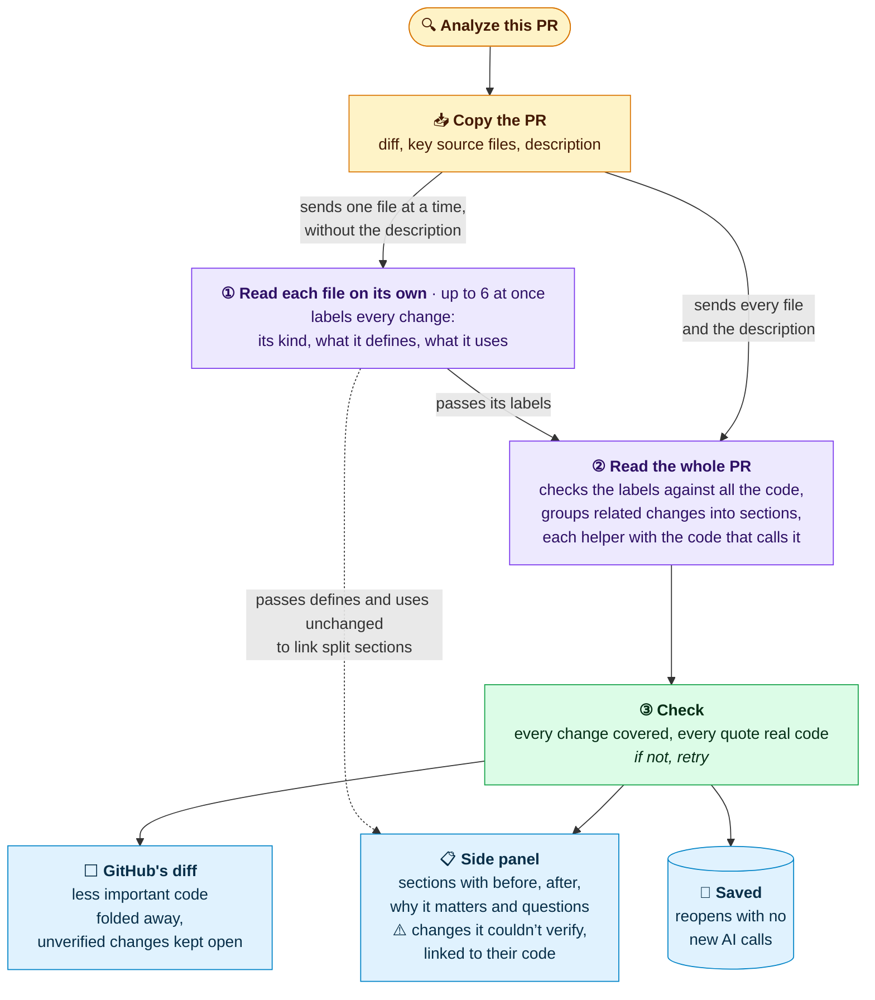

# PRiorities

Focus GitHub code reviews on the changes that need your judgment.

PRiorities is a Chrome extension that uses your local Codex or Claude Code login to explain changes in Chrome’s side panel while you review GitHub’s own diff. It classifies each file separately, with up to six files in parallel by default, then reviews the whole PR to choose what needs attention.

- Read numbered, expandable sections in plain language, each following one changed flow with its implementation, callers and tests together. Each section explains before/after behavior, why it matters and its review questions. When a changed definition and its use still land in different sections, both sections link to each other by symbol name. File names, cited line ranges and linked code identifiers jump to the matching code in GitHub.
- Fold supporting changes and unchanged context behind grey markers in GitHub’s Unified diff. Review decisions, their cited evidence, unresolved edits and your always-visible types and paths stay open until you mark their section done. Expand any fold or turn folding off; GitHub’s comments and review controls stay in place. Split view stays unchanged.
- Choose review focus, custom analysis prompts, your CLI model and reasoning effort in Settings. Analyze the full PR or the commit range selected in GitHub, with source context and saved reviews matched to those commits.
- Skip generated and machine-maintained files by default, with **Review anyway** in the file list. Analyze up to 100 changed files by default, configurable from 1–300; optionally list deleted files without sending their contents to the AI or counting them toward that limit.
- Follow analysis steps, elapsed time and file progress in the panel. Retry individual files or the whole-PR review without repeating completed classifications. Once capture finishes, analysis continues across panel closure, GitHub navigation and page reloads in the same browser tab.
- Tick a section done in one of its files to fold that section’s lines there; lines another section also changes or cites stay visible until that section is done too. These folds get their own green **reviewed** markers. Once every section listing a file is done, PRiorities ticks GitHub’s **Viewed** checkbox for it; for a file GitHub has not loaded yet, that waits until it loads while the panel stays open on this PR’s diff. **Reviewed** in the panel’s progress list operates **Viewed** directly. Ticks are saved with the review and kept across retries while their section adds nothing new in that file, and your review progress stays separate from AI analysis.
- Reopen completed reviews from a local cache: 100 MB by default, customizable in Settings. Commit or context changes require a fresh review; the cache evicts the least recently used entries when full.

## How it works



Each section is marked **Review** or **Supporting**; Supporting doesn’t mean the change is safe. The default instructions, which you can replace in Settings, ask the model to:

- mark **Review** for consequential behavior changes, concrete failure paths, mismatches between what the PR says and what the code does, contracts, security, correctness, and uncertainty that matters;
- mark **Supporting** only with a reason from the code for giving it less attention, never file type alone;
- order sections so one that another builds on comes first, whatever its label, since the label signals attention, not reading order.

The count at the top of a review, such as “2 review decisions”, counts Review sections. With folding on, the default, a Review section’s changes and the code it cites stay open in GitHub’s diff, while a Supporting section’s changes fold behind grey markers, except unresolved edits, code a Review section cites, and your always-visible change types and paths. Once you mark done every section that changes or cites a line, that line folds too, behind a green reviewed marker, whatever the label.

The grouping follows code-review research on keeping related changes together ([notes](review-literature-research.md)). Whether it helps reviewers catch more defects is still untested.

## Install

Requires Google Chrome 133 or later on macOS, Node.js 24, and a signed-in Codex or Claude Code CLI.

```sh
git clone https://github.com/goncalvesnelson/PRiorities.git
cd PRiorities
npm ci
npm run build:extension
npm run install:cli-host
```

1. Open `chrome://extensions` and enable **Developer mode**.
2. Choose **Load unpacked** and select this repository's `extension/` directory.
3. Open **PRiorities** from Chrome's extensions menu, choose **Settings**, select your CLI, model and reasoning effort, then save.
4. Open a GitHub PR, open **PRiorities** again and choose **Analyze this PR**. The popup opens the side panel and starts analysis, opening **Files changed** first if needed. If a matching saved review exists, it checks and opens that review instead.

The helper uses your existing CLI login. If needed, sign in with `codex login` or `claude auth login`. Chrome starts the helper on demand; no separate service needs to keep running.

See [the extension guide](EXTENSION.md) for review controls, cache behavior, context capture, and troubleshooting boundaries.

## Data and review limits

Analysis starts when you request it. The selected CLI sends the captured PR evidence to its model provider; this uses your account's allowance. Login credentials stay with the CLI. Completed review results and selected excerpts are cached locally in the extension.

Prioritization is a model judgment. Supporting changes remain accessible, and unresolved edits stay visible. You control each file’s Viewed mark; completing AI analysis never sets it. PRiorities doesn't submit comments or approve PRs.

## Development

```sh
npm run verify:extension
```

This builds the extension and runs native-host, background/runtime, and installed-extension browser checks. Tests use public or synthetic GitHub fixtures and fake CLIs; they don't send code to a live model. The browser checks require Google Chrome at its standard macOS installation path. `npm run verify` runs the same suite.

After pulling changes, run `npm ci`, `npm run build:extension`, and `npm run install:cli-host`, then reload the extension in Chrome and refresh the PR tab. The installer updates Chrome’s copied helper; reloading the extension alone does not. Live model progress needs the current helper: without rerunning `npm run install:cli-host`, analysis still works but shows only its steps and timer. Preserve any custom `CODEX_HOME` or `CLAUDE_CONFIG_DIR` when rerunning it.

The earlier standalone prototype and its captured private PR data remain outside this repository. Tests here don't require another repository checkout.

Research notes: [review literature, approach assessment and evaluation plan](review-literature-research.md), [Laya assessment](laya-fit-research.md), and [GitHub integration options](pr-lens-research.md).
